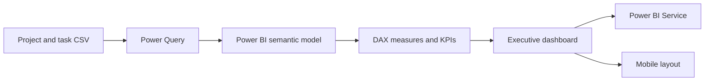

# Green Olive Tree Executive Dashboard

An executive reporting project built in Power BI to monitor a portfolio of projects, budgets, task delivery, overdue work, and risk. It includes the Power BI report, the CSV source dataset, and screenshots of the report in desktop and mobile layouts.

> **Portfolio demonstration:** Green Olive Tree is an invented company, and the project/task data, names, and figures are improvised synthetic data created for practice. This is a learning dashboard, not live company reporting. The dataset contains 504 task records across 28 projects.

## Dashboard preview

### Executive dashboard


### Mobile layout


## Architecture



The report uses a project/task dataset as its source, shapes the fields for reporting in Power Query, and presents measures and visuals in a Power BI report. The PBIX is the editable project file; the CSV is included so the source data is available alongside it.

## Business questions explored

- How do allocated budgets compare with actual spend by project?
- How many tasks are completed, in progress, not started, or overdue?
- Which projects may need follow-up because of overdue or higher-risk work?
- How much budget remains across the portfolio?
- How can an executive summary be presented alongside detailed project comparisons?

## Example insights from the report

- The portfolio contains **28 projects** and **504 tasks**.
- Total allocated budget is approximately **$1.38M**; actual cost is approximately **$694K**.
- The report shows approximately **$683K** of budget remaining.
- **122 tasks are overdue**; the report highlights overdue delivery as an area for attention.
- The dashboard combines portfolio-level KPI cards, project budget comparisons, task-status distribution, and narrative insight panels.

Figures are rounded as displayed in the report and depend on the included sample dataset.

## Report overview and business context


Green Olive Tree is a fictional, family-run olive-oil business used to make a realistic portfolio-planning scenario. The report presents 28 initiatives across eight operation lines and is designed to help leaders assess delivery progress, budget position, and risk. It guides readers from the Executive Overview to Task Delivery & Risk, then to a project-level task register through drill-through.

### Questions the report answers

- How many initiatives and tasks are active, and how far along are they?
- Are costs within budget, and which initiatives are nearing their limits?
- Where is overdue work concentrated, and are high-risk tasks progressing?
- For a selected initiative, who owns the work, what is late, and how much budget remains?

### Illustrative findings

- **Budget:** About **$1.38M** approved, **$0.69M** spent (50%), and **$0.68M** remaining; no initiative is over budget.
- **Budget watchlist:** Graham and Sons (97%), Mason, Andersen and Nelson (96%), Morrison-Davis (90%), and Page, Douglas and Cunningham (85%) are near their allocated ceilings.
- **Delivery:** Of 504 tasks, about 23% are complete, 27% are in progress, 25% have not started, and 122 (24%) are flagged overdue.
- **Risk:** 181 tasks (36%) are classified as high risk; 137 remain open and 40 are already overdue.
- **Suggested focus:** Larson-Wilkins has the most overdue (8) and high-risk (11) tasks. Morrison-Davis and Page, Douglas and Cunningham each combine high spend with seven overdue tasks.

These are scenario findings from improvised data, not operational facts about a real company. Percentages are rounded as shown in the report.

### Stakeholders and navigation

The report is intended to support a Managing Director's portfolio view, a Finance Controller's budget monitoring, and Operations and Quality & Compliance leaders' delivery and risk follow-up. Commercial leads and project owners can use the report to review revenue-facing work and task ownership. Start with Executive Overview, use Task Delivery & Risk to investigate exceptions, and drill through a project to inspect its task register.

### Data and model notes

The report's About panel describes an improvised source with 504 task records, 28 projects, and 11 fields, shaped in Power Query into a project dimension, task fact table, and fiscal date table for FY2024/25. It also notes that names are fictional, amounts are USD, the illustrated due date is 6 August 2024, each task maps to an operation line, and project budgets are split evenly across tasks for task-level views.

The companion CSV included in this repository has 18 columns, including project/task attributes, operation-line mapping, and task-level budget fields. The report overview and supplied CSV therefore describe different source schemas; if Power BI requests a source or refresh mapping, confirm the query's expected column names before refreshing. The dataset and all displayed values are illustrative.

## Files

```text
green-olive-tree-executive-dashboard/
├── Green Olive Tree - Executive Report.pbix
├── Green_Olive_Tree_project_tasks_USD.csv
├── README.md
├── report-overview.png
├── executive-dashboard.png
└── dashboard-mobile-layout.png
```

## Open the project

1. Install [Power BI Desktop](https://powerbi.microsoft.com/desktop/).
2. Download or clone this repository.
3. Open `Green Olive Tree - Executive Report.pbix` in Power BI Desktop.
4. If Power BI prompts for the source file, select `Green_Olive_Tree_project_tasks_USD.csv` from this folder and confirm the data source settings.
5. Select **Refresh** to reload the included data.

The screenshots are static previews. Publishing a refreshed version to Power BI Service requires signing in with an account that has access to a workspace and using Power BI's publish workflow.

## Skills demonstrated

- Power Query data preparation and source management
- KPI and measure design in Power BI
- Executive dashboard layout and visual communication
- Budget-versus-actual analysis
- Task status, overdue work, priority, and risk reporting
- Desktop and mobile report presentation

## Future roadmap

- Add a data dictionary and document measure definitions
- Add an executive project-detail drill-through page
- Validate team-member counts against distinct people rather than task-row counts
- Add a refresh checklist and data-quality checks
- Refine accessibility with contrast, labels, and keyboard navigation
