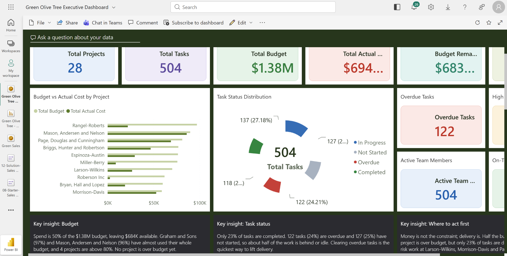
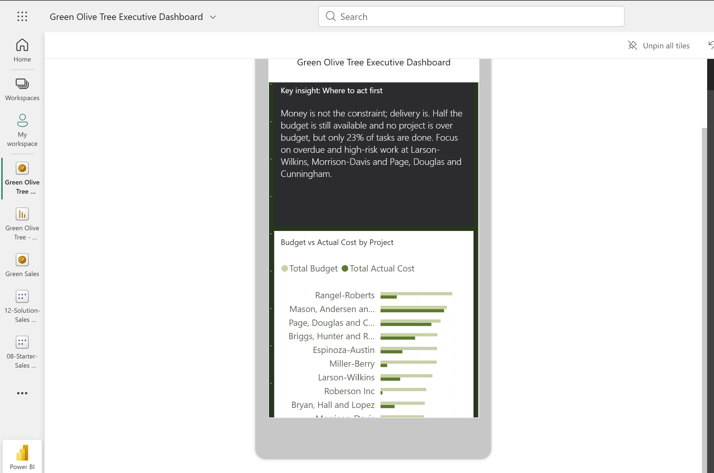
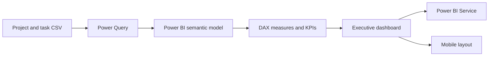
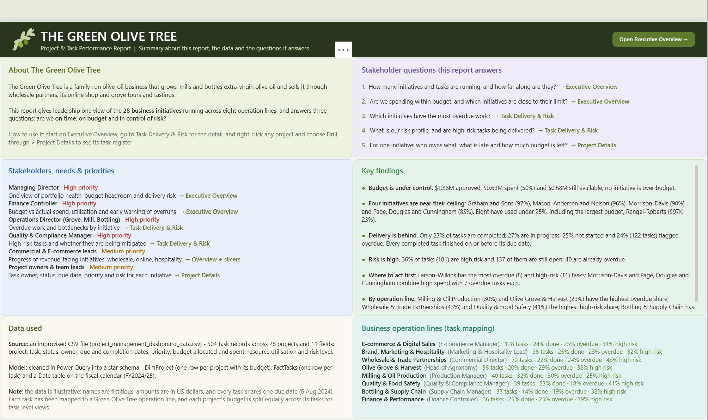

# Green Olive Tree Executive Dashboard

A Power BI portfolio project: an executive report that monitors a portfolio of projects, budgets, task delivery, overdue work, and risk. The repository contains the Power BI report, the CSV source extract, and screenshots of the report in desktop and mobile layouts.

The project covers 28 projects and 504 tasks, and shows how requirements gathering, data preparation, modelling, and visual design come together in one stakeholder-ready report.

## Dashboard preview

### Executive dashboard



### Mobile layout



## Architecture



The report uses a project/task dataset as its source, shapes the fields for reporting in Power Query, and presents measures and visuals in a Power BI report. The PBIX is the editable project file; the CSV is included so the source data is available alongside it.

## Business questions explored

- How do allocated budgets compare with actual spend by project?
- How many tasks are completed, in progress, not started, or overdue?
- Which projects may need follow-up because of overdue or higher-risk work?
- How much budget remains across the portfolio?
- How can an executive summary be presented alongside detailed project comparisons?

## Key results

- The portfolio contains **28 projects** and **504 tasks**, each assigned to a distinct team member.
- Total allocated budget is approximately **$1.38M**; actual cost is approximately **$694K**.
- Approximately **$683K** of budget remains.
- **122 tasks are overdue**; the report highlights overdue delivery as the main area for attention.
- The dashboard combines portfolio-level KPI cards, project budget comparisons, task-status distribution, and narrative insight panels.

Figures are rounded as displayed in the report.

## Report overview and business context



The report is built around The Green Olive Tree, a family-run olive-oil business that grows, mills and bottles extra-virgin olive oil. It presents 28 initiatives across eight operation lines and helps leaders assess delivery progress, budget position, and risk. It guides readers from the Executive Overview to Task Delivery & Risk, then to a project-level task register through drill-through.

### Questions the report answers

- How many initiatives and tasks are active, and how far along are they?
- Are costs within budget, and which initiatives are nearing their limits?
- Where is overdue work concentrated, and are high-risk tasks progressing?
- For a selected initiative, who owns the work, what is late, and how much budget remains?

### Key findings

- **Budget:** About **$1.38M** approved, **$0.69M** spent (50%), and **$0.68M** remaining; no initiative is over budget.
- **Budget watchlist:** Graham and Sons (97%), Mason, Andersen and Nelson (96%), Morrison-Davis (90%), and Page, Douglas and Cunningham (85%) are near their allocated ceilings.
- **Delivery:** Of 504 tasks, about 23% are complete, 27% are in progress, 25% have not started, and 122 (24%) are flagged overdue.
- **Risk:** 181 tasks (36%) are classified as high risk; 137 remain open and 40 are already overdue.
- **Suggested focus:** Larson-Wilkins has the most overdue (8) and high-risk (11) tasks. Morrison-Davis and Page, Douglas and Cunningham each combine high spend with seven overdue tasks.

Percentages are rounded as shown in the report.

### Stakeholders and navigation

The report supports a Managing Director's portfolio view, a Finance Controller's budget monitoring, and Operations and Quality & Compliance leaders' delivery and risk follow-up. Commercial leads and project owners can use it to review revenue-facing work and task ownership. Start with Executive Overview, use Task Delivery & Risk to investigate exceptions, and drill through a project to inspect its task register.

### Data and model notes

The report's About panel describes a source of 504 task records and 11 fields, shaped in Power Query into a star schema: a project dimension (`DimProject`), a task fact table (`FactTasks`), and a fiscal date table for FY2024/25. Amounts are in USD, all tasks use the due date 6 August 2024, each task maps to an operation line, and project budgets are split evenly across tasks for task-level views.

The CSV in this repository is a wider extract of the same dataset: it has 18 columns, including operation-line mapping and task-level budget fields that were not all loaded into the report. If Power BI asks for the source file, select `Green_Olive_Tree_project_tasks_USD.csv` and confirm the query's expected column names before refreshing.

See [REQUIREMENTS_AND_DATA_DICTIONARY.md](REQUIREMENTS_AND_DATA_DICTIONARY.md) for stakeholder requirements, the data model, a column-by-column data dictionary, and measure descriptions.

### Report pages

| Page | Purpose |
|---|---|
| About this Report | Business context, stakeholders and priorities, questions answered, key findings, data used |
| Executive Overview | Portfolio KPIs, budget vs actual by project, task status distribution, key insights |
| Task Delivery & Risk | Overdue and high-risk work by project and operation line, with slicers |
| Project Details | Drill-through task register for a selected project: owner, status, due date, priority, risk, budget |

### DAX measures

Total Projects, Total Tasks, Total Budget, Total Actual Cost, Budget Variance, Budget Utilization %, Overdue Tasks, High Risk Tasks, On-Time Completion %, Budget Status Colour, and Selected Project.

## Files

```text
green-olive-tree-executive-dashboard/
├── Green Olive Tree - Executive Report.pbix
├── Green_Olive_Tree_project_tasks_USD.csv
├── README.md
├── REQUIREMENTS_AND_DATA_DICTIONARY.md
├── report-overview.png
├── executive-dashboard.png
└── dashboard-mobile-layout.png
```

## Open the project

1. Install [Power BI Desktop](https://powerbi.microsoft.com/desktop/).
2. Download or clone this repository.
3. Open `Green Olive Tree - Executive Report.pbix` in Power BI Desktop.
4. If Power BI prompts for the source file, select `Green_Olive_Tree_project_tasks_USD.csv` from this folder and confirm the data source settings.
5. Select **Refresh** to reload the included data.

The screenshots are static previews. Publishing a refreshed version to Power BI Service requires signing in with an account that has access to a workspace and using Power BI's publish workflow.

## Skills demonstrated

- Requirements gathering: stakeholders, needs, priorities, and the questions the report must answer
- Power Query data preparation and star-schema modelling
- KPI and measure design in DAX
- Executive dashboard layout, drill-through navigation, and visual communication
- Budget-versus-actual analysis
- Task status, overdue work, priority, and risk reporting
- Desktop and mobile report presentation

## Future roadmap

- Document the exact DAX definition of each measure
- Add a refresh checklist and data-quality checks
- Refine accessibility with contrast, labels, and keyboard navigation
