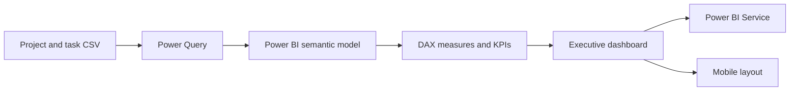

# Green Olive Tree Executive Dashboard

An executive reporting project built in Power BI to monitor a portfolio of projects, budgets, task delivery, overdue work, and risk. It includes the Power BI report, the CSV source dataset, and screenshots of the report in desktop and mobile layouts.

> **Portfolio demonstration:** Green Olive Tree is an invented company, and the project/task data, names, and figures are improvised synthetic data created for practice. This is a learning dashboard, not live company reporting. The dataset contains 504 task records across 28 projects.

## Dashboard preview

### Executive dashboard


### Mobile layout


## Architecture



The report uses a project/task dataset as its source, shapes the fields for reporting in Power Query, and presents measures and visuals in a Power BI report. The PBIX is the editable project file; the CSV is included so the source data is available alongside it.

## Business questions explored

- How do allocated budgets compare with actual spend by project?
- How many tasks are completed, in progress, not started, or overdue?
- Which projects may need follow-up because of overdue or higher-risk work?
- How much budget remains across the portfolio?
- How can an executive summary be presented alongside detailed project comparisons?

## Example insights from the report

- The portfolio contains **28 projects** and **504 tasks**.
- Total allocated budget is approximately **$1.38M**; actual cost is approximately **$694K**.
- The report shows approximately **$683K** of budget remaining.
- **122 tasks are overdue**; the report highlights overdue delivery as an area for attention.
- The dashboard combines portfolio-level KPI cards, project budget comparisons, task-status distribution, and narrative insight panels.

Figures are rounded as displayed in the report and depend on the included sample dataset.

## Files

```text
green-olive-tree-executive-dashboard/
├── Green Olive Tree - Executive Report.pbix
├── Green_Olive_Tree_project_tasks_USD.csv
├── README.md
├── executive-dashboard.png
└── dashboard-mobile-layout.png
```

## Open the project

1. Install [Power BI Desktop](https://powerbi.microsoft.com/desktop/).
2. Download or clone this repository.
3. Open `Green Olive Tree - Executive Report.pbix` in Power BI Desktop.
4. If Power BI prompts for the source file, select `Green_Olive_Tree_project_tasks_USD.csv` from this folder and confirm the data source settings.
5. Select **Refresh** to reload the included data.

The screenshots are static previews. Publishing a refreshed version to Power BI Service requires signing in with an account that has access to a workspace and using Power BI's publish workflow.

## Skills demonstrated

- Power Query data preparation and source management
- KPI and measure design in Power BI
- Executive dashboard layout and visual communication
- Budget-versus-actual analysis
- Task status, overdue work, priority, and risk reporting
- Desktop and mobile report presentation

## Future roadmap

- Add a data dictionary and document measure definitions
- Add an executive project-detail drill-through page
- Validate team-member counts against distinct people rather than task-row counts
- Add a refresh checklist and data-quality checks
- Refine accessibility with contrast, labels, and keyboard navigation


